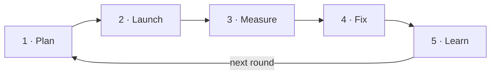

# The loop

Every round goes around this loop once. Each time around, we fix one leak and write down one
lesson, so the next round starts smarter.



A **round** is one Meta campaign (or one ad set inside it) with one goal, run long enough to judge.
Folder: `companies/<company>/campaigns/<yyyy-mm>-<name>-v<n>/`.

## 1 · Plan

1. Read `playbook/lessons.md`, the company's `company.md` and `content.md`, and its last `results.md`.
2. Set the goal (from `LADDER.md`) and the target cost for the early signal, with Badi.
3. Pick the **biggest leak** from the last results (the script names it under "Fix next").
   First round for a company? It's the baseline: change nothing, just measure.
4. Change **one thing** to fix that leak: the creative angle, the hook, the format, the audience,
   the placements, the offer, the landing (store page, WhatsApp greeting), or the budget.
5. Write the bet: "If we do X, step Y goes from A% to B%."
6. Make the round folder from `companies/_template/campaigns/_template`.

## 2 · Launch

1. Run [LAUNCH-CHECKLIST.md](LAUNCH-CHECKLIST.md). Any red → fix first.
2. Show Badi the copy as plain text and the exact setup. **Nothing goes live without his OK.**
3. Build it in the Meta connector, put the IDs in `campaign.json`, write `first_live` and `last_change`.

## 3 · Measure

1. Pull the numbers from the Meta Ads connector (fields in `CLAUDE.md`) and write `pulled.json`:

```json
{
  "pulled_at": "2026-10-20T09:00",
  "source": "Meta Ads connector, date_preset=maximum",
  "hooked_metric": "3-second video plays",
  "totals": {"spend": 0, "impressions": 0, "reach": 0, "frequency": 0, "clicks": 0, "installs": 0},
  "ads": [{"id": "", "name": "", "status": "", "spend": 0, "impressions": 0, "reach": 0,
           "clicks": 0, "installs": 0, "hooked": null, "thruplays": null}],
  "placements": [{"platform": "instagram", "position": "feed", "spend": 0, "impressions": 0,
                  "clicks": 0, "installs": 0}]
}
```

   Use the early-signal key of the goal: `installs`, `conversations` or `leads`.
2. Type the numbers Meta can't see into `campaign.json` → `manual`: trials and paid subs,
   qualified chats and sales, booked and won. Also `rejected_ads` and `learning_limited`.
3. Run `python3 scripts/ladder.py companies/<company>/campaigns/<round>`.
4. Score as often as you like, but **don't judge until 7 days after the last change.**

## 4 · Fix

1. Red health light? It's a setup problem. Fix it, then rerun. Don't blame the creative.
2. Compare with the baseline. The script suggests **keep** or **drop**, judged only on the step
   we tried to fix.
3. Badi makes the final call. Write it in `campaign.json` → `verdict`.
4. Update `content.md`: winners stay on and get new variations, losers get retired.

## 5 · Learn

1. Add one line to `playbook/lessons.md`: what we changed, what happened (with numbers),
   the lesson, and whether it applies to all companies or just this one.
2. If something won, add it to `playbook/what-works.md`.
3. Update the company's "what we know works here" list.
4. Commit everything to GitHub with a clear message. That's our history.

## Control vs challenger

Inside a round, the current best ad (the control) runs next to new challengers that differ in
**one thing**: the hook, the angle, or the format. Meta spends more on what it likes, so an ad
with little spend isn't a loser yet: it's untested. When a challenger beats the control on the
score's early signal with enough impressions, it becomes the new control.

## The rules that keep it honest

- One change per round.
- 1,000 impressions per ad, the minimum people per step in `targets.json`, 7 days after a change.
- Red health light = setup problem, never a creative verdict.
- Judge by placement, not blended totals.
- The real end of the goal is the score. Everything else is there to find the leak.
- Never delete an old round. Dropped rounds teach as much as winners.
