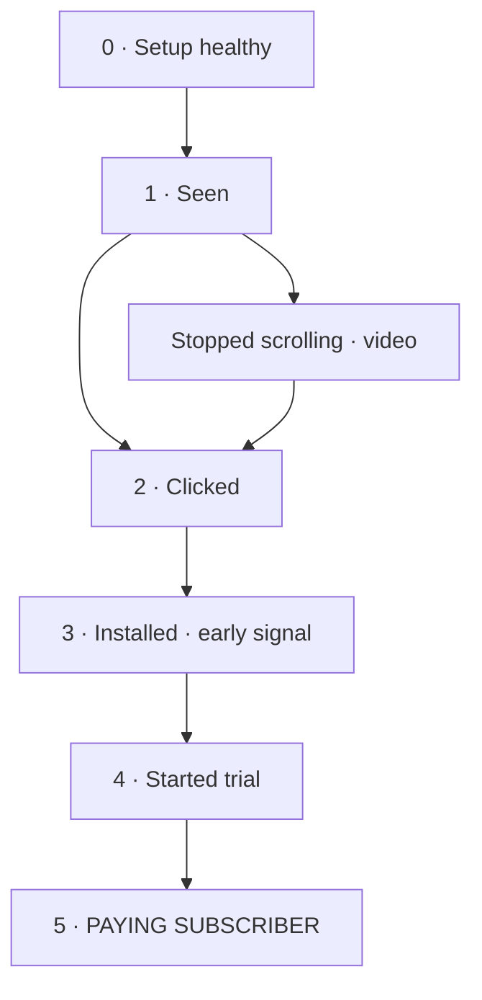

# Meta ads loop

Our system for getting better results from Meta ads, across every company we run.
Every round is a test: we pick the goal, run the ads, find where people drop off, fix one thing,
write down what we learned, and the next round starts smarter.

**Claude runs the operation. Badi supervises.** Badi approves every launch, budget change, pause,
creative and keep/drop call. See [OPERATIONS.md](OPERATIONS.md).

## The ladder (app example)

WhatsApp and lead rounds use the same idea with their own steps (conversation → qualified → sale,
or lead → booked → won). Every step has a red / yellow / green target, with sources.
See [LADDER.md](LADDER.md). Health lights can veto any result.

## The loop

**Plan → Launch → Measure → Fix → Learn**, one change per round. See [LOOP.md](LOOP.md).

## Where content comes from

1. What Badi uploads.
2. Posts already on each company's Facebook and Instagram.
3. Later: posting organic first and turning the winners into ads (needs a posting tool).

Every piece gets an ID in the company's `content.md`, so we know which angle won.

## What's where

| File | What it is |
|---|---|
| [OPERATIONS.md](OPERATIONS.md) | Who decides what, plus the daily / weekly / monthly rhythm |
| [LADDER.md](LADDER.md) | The goals, the steps, the targets, and the sources |
| [LOOP.md](LOOP.md) | How one round goes around the loop, and how numbers get in |
| [LAUNCH-CHECKLIST.md](LAUNCH-CHECKLIST.md) | Step 0, checked before every launch |
| [targets.json](targets.json) | The target numbers the script uses |
| `companies/` | One folder per company: `company.md`, `content.md`, and its rounds |
| `companies/SCOREBOARD.md` | The score per company, plus every round in one table |
| `playbook/` | Lessons, what works, test ideas, learning log |
| `scripts/ladder.py` | Scores a round, writes results.md, rebuilds the scoreboard |
| `examples/` | A fake app to show what a judged round looks like |
| `CLAUDE.md` | Instructions Claude follows when working in this repo |

## Getting started

1. Open this repo with Claude (the `meta-ads` skill does it for you).
2. Make sure the Meta Ads connector is on in that chat.
3. Tell Claude "where are we" (`/status`), or "add a company" (`/new-company legon-cali`).
4. Then `/content`, `/plan`, `/creative`, `/launch`, `/score`, `/lesson`. Each one explains itself.

To see a judged example: `python3 scripts/ladder.py examples/demo-app/campaigns/2026-09-v2`
